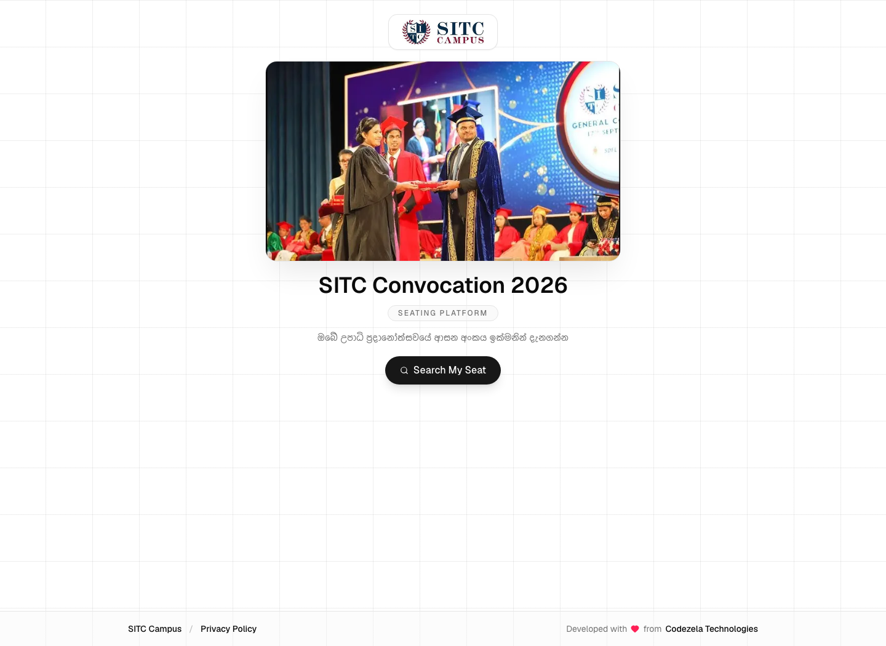
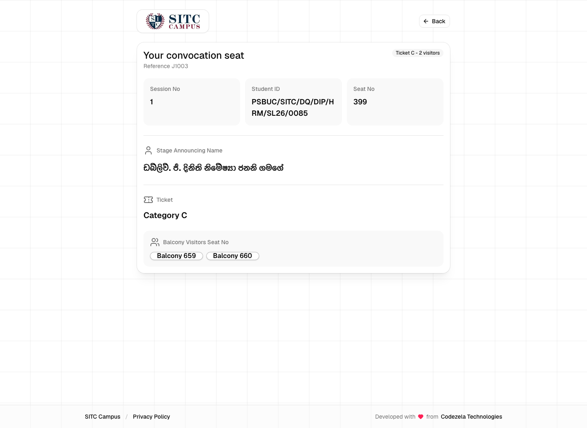
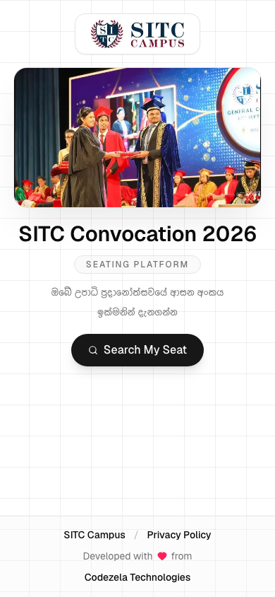
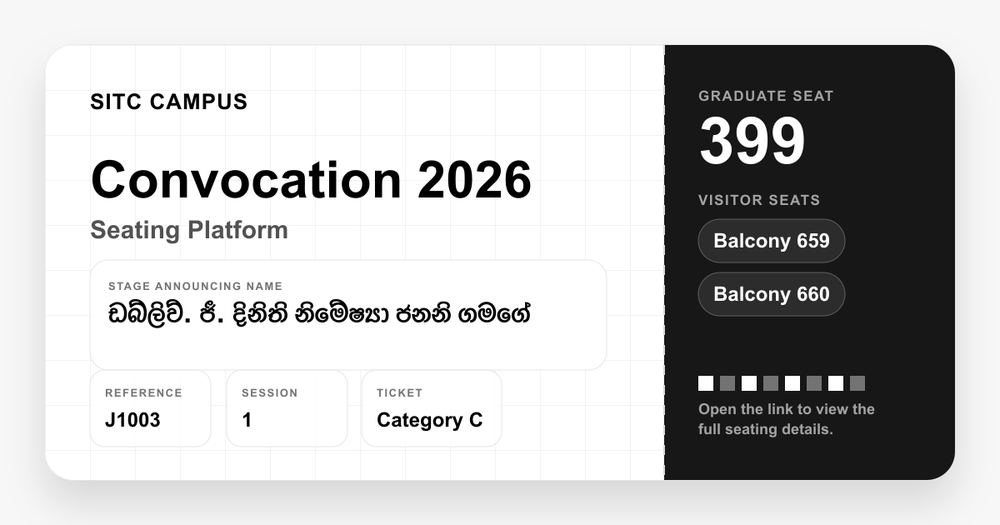
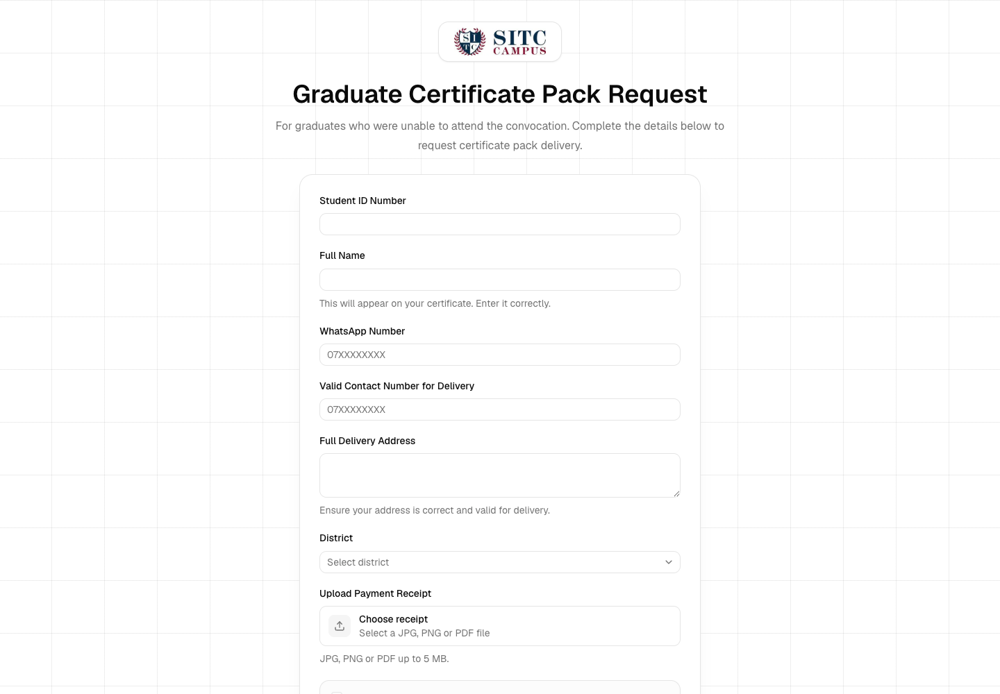
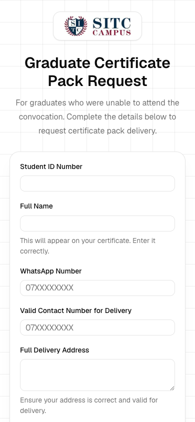

<p align="center">
  <a href="https://sitc.lk" target="_blank" rel="noreferrer">
    
  </a>
</p>

<h1 align="center">SITC Convocation 2026 Platform</h1>

<p align="center">
  A polished Next.js platform for graduates to find their convocation seats and request delivery of certificate packs.
</p>

<p align="center">
  <a href="https://convocation.sitc.lk"></a>
  
  
  
  
  
  
  
  
</p>

## Preview

| Public Search | Result Page |
|---|---|
|  |  |

| Mobile Home | Social Share Card |
|---|---|
|  |  |

| Certificate Request | Mobile Certificate Request |
|---|---|
|  |  |

## What It Does

- Public search flow with SITC logo, convocation hero image, Sinhala helper text, and a smooth reference ID popup.
- Private result pages at `/result/[referenceId]` showing Session No, Student ID, Seat No, Stage Announcing Name, Ticket, and Balcony Visitors Seat No.
- Ticket logic for visitor seats: Category A is graduate only, Category B allows one visitor seat, and Category C allows two visitor seats.
- Hidden admin area at `/hidden-admin` with seeded admin login, paginated dashboard, manual CRUD, Excel upload, validation preview, and sample workbook download.
- Graduate Certificate Pack request form with all 25 Sri Lankan districts, strict phone and receipt validation, and a clear submission confirmation.
- Certificate administration at `/hidden-admin/certificate` with search, status filters, pagination, details, private receipt downloads, manual creation, editing, and deletion.
- Private payment receipts stored in Backblaze B2 with server-side encryption and short-lived authenticated download links.
- Robust Excel header handling for real-world sheets, including typo-tolerant mapping such as `SEET No` to `Seat No`.
- Dynamic Open Graph and Twitter card images for result links, generated as ticket-style PNGs with Sinhala font shaping.
- Public pages include SITC Campus, Privacy Policy, and Codezela Technologies footer links.

## Features

- **🔍 Seat Lookup** — Graduates enter a Reference ID and instantly find their seating assignment.
- **🎟️ Social Share Cards** — Dynamic OG/Twitter images render a branded ticket-style PNG with Sinhala text via Sharp.
- **🛡️ Hidden Admin Panel** — Secure JWT-authenticated area for managing student records.
- **📊 Excel Import** — Bulk-upload `.xlsx` files with fuzzy header matching that handles typos and alternate column names.
- **📱 Fully Responsive** — Polished experience across desktop and mobile devices.
- **🌐 SEO Optimized** — Public pages are indexed; admin, API, and result pages are excluded from search engines.
- **🏢 Ticket Categories** — Enforces A/B/C rules with corresponding balcony visitor seat validation.
- **📦 Certificate Requests** — Complete public intake and uncluttered admin management workflow.
- **🔒 Private Receipts** — Binary-signature validation, encrypted private B2 objects, and 60-second admin-only download URLs.

## Screens And Routes

| Route | Purpose | Indexing |
|---|---|---|
| `/` | Public seat search page | Indexable |
| `/result/[referenceId]` | Shareable private seating result | `noindex` |
| `/certificate-request` | Graduate Certificate Pack delivery request | Indexable |
| `/hidden-admin` | Admin sign in | Blocked and `noindex` |
| `/hidden-admin/dashboard` | Admin import and CRUD dashboard | Blocked and `noindex` |
| `/hidden-admin/certificate` | Certificate request administration | Blocked and `noindex` |
| `/api/sample-format` | Downloads the Excel sample format | API `noindex` |

## Tech Stack

- **Framework:** Next.js 16 App Router
- **Language:** TypeScript 5
- **Styling:** Tailwind CSS 4 + shadcn-style UI components
- **Animations:** Motion (formerly Framer Motion)
- **Database:** Prisma 6 with local SQLite (dev) / MySQL (production)
- **Authentication:** JWT (HS256) via `jose` + `bcryptjs`
- **Excel Parsing:** ExcelJS for workbook reading and sample generation
- **Image Generation:** Sharp for correctly shaped Sinhala social-card PNGs
- **Private File Storage:** Backblaze B2 through its S3-compatible API
- **Validation:** Zod
- **Testing:** Vitest

## Local Setup

```bash
npm install
cp .env.example .env
npm run db:setup
npm run dev
```

Open:

- Public site: `http://localhost:3000`
- Admin: `http://localhost:3000/hidden-admin`

Admin credentials are read from `.env` and used only for local setup and seeding. Keep the real `.env` file private.

## Environment

| Variable | Purpose |
|---|---|
| `DATABASE_URL` | SQLite locally; MySQL on the production VPS |
| `ADMIN_EMAIL` | Seeded administrator identity |
| `ADMIN_PASSWORD` | Bootstrap-only administrator password |
| `SESSION_SECRET` | JWT signing and source-HMAC secret, at least 32 characters |
| `NEXT_PUBLIC_SITE_URL` | Canonical public origin |
| `B2_S3_ENDPOINT` | Backblaze B2 S3-compatible regional endpoint |
| `B2_REGION` | B2 bucket region |
| `B2_BUCKET_NAME` | Private payment receipt bucket |
| `B2_KEY_ID` | Bucket-scoped B2 application key ID |
| `B2_APPLICATION_KEY` | Bucket-scoped B2 application key secret |

Before production, set `NEXT_PUBLIC_SITE_URL` to the final HTTPS domain. It controls canonical URLs, social image URLs, `robots.txt`, and `sitemap.xml`. The B2 bucket must remain private and the application key must be restricted to that bucket with only the file capabilities required by this app.

## Certificate Request Workflow

The public form requires a Student ID, certificate name, WhatsApp number, delivery contact number, full address, district, payment receipt, and confirmation. JPG, PNG, and PDF receipts are limited to 5 MB and validated from their binary signatures rather than trusting the browser-provided file name or MIME type.

Successful submissions upload the receipt to a private B2 object and then create the database record. If the database write fails, the uploaded object is removed. Admin deletion also removes both the request and its receipt. Receipt downloads require a valid admin session and redirect to a signed URL that expires after 60 seconds.

Certificate request statuses are `Pending`, `Verified`, `Preparing`, `Dispatched`, `Completed`, and `Rejected`. Courier references and private internal notes can be maintained from the admin detail dialog.

## Excel Import Format

The admin dashboard accepts `.xlsx` files with these fields:

| Column | Required | Notes |
|---|---|---|
| Reference ID | Yes | Public lookup value used by the graduate |
| Session No | Yes | Convocation session number |
| Student ID | Yes | Graduate student ID |
| Seat No | Yes | Graduate seat number |
| Stage Announcing Name | Yes | Name shown on result and social card |
| Ticket | Yes | `A`, `B`, or `C` |
| Balcony Visitors Seat No | Based on ticket | Empty for A, one seat for B, two seats for C |

The sample file can be downloaded from the admin dashboard or directly from `/api/sample-format`.

## Data And Migration Notes

The current database uses Prisma with SQLite for simple local operation:

- Schema: `prisma/schema.prisma`
- MySQL variant: `prisma/schema.mysql.prisma`
- Migrations: `prisma/migrations/000001_init/migration.sql` and `prisma/migrations/000002_certificate_requests/migration.sql`
- Seed script: `prisma/seed.ts`
- Local database: `prisma/dev.db`, ignored by Git

Production uses the matching MySQL schema in `prisma/schema.mysql.prisma`. The certificate migration is additive and does not alter existing seating or admin records.

## SEO, Privacy, And Sharing

- The homepage and certificate request page are included in `sitemap.xml`.
- Admin and API routes are blocked through `robots.txt` and `X-Robots-Tag`.
- Result pages are not blocked by `robots.txt` so social platforms can fetch previews.
- Result pages still send `noindex`, `nofollow`, and `noarchive` headers because they contain student seating data.
- Result links generate detailed social preview cards without adding those private pages to search engines.
- Certificate administration and receipt download routes require authentication and are excluded from indexing.

## Production Checklist

```bash
npm run lint
npm test
npm run build
npm run start
```

For a MySQL-backed production host, generate the Prisma client from the MySQL schema before building:

```bash
npm run db:generate:mysql
npm run db:push:mysql
npm run build:mysql
```

Before publishing:

- Set a strong `SESSION_SECRET` (minimum 32 characters).
- Set final `ADMIN_EMAIL` and `ADMIN_PASSWORD`, run the seed once, then remove the seed password from production secrets if your hosting flow allows it.
- Set `NEXT_PUBLIC_SITE_URL` to the final HTTPS domain before building.
- Confirm the social card URL `/result/[referenceId]/opengraph-image` returns a PNG.
- Confirm `/robots.txt` allows social preview crawling while admin/API routes remain blocked.
- Verify the private B2 bucket is reachable with the configured application key.
- Submit, edit, download, and delete one certificate request, then confirm its B2 object is removed.

## License

This software is proprietary and confidential. See the [LICENSE](./LICENSE) file for full terms.

Copyright &copy; 2026 SITC Campus. All rights reserved.

## Credits

- **SITC Campus:** [sitc.lk](https://sitc.lk)
- **Privacy Policy:** [sitc.lk/privacy-policy](https://sitc.lk/privacy-policy/)
- **Developed by** [Codezela Technologies](https://codezela.com)
